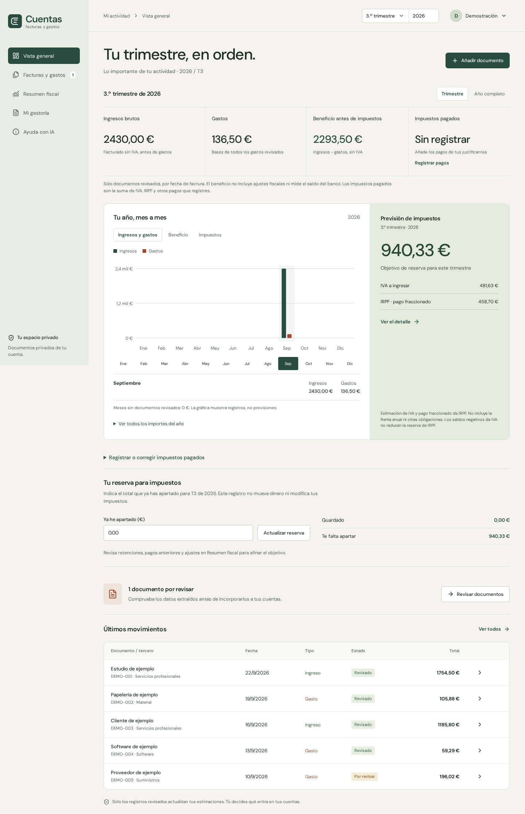
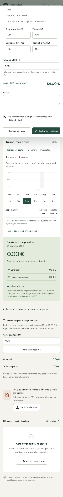

[English](README.md) · Español

# Cuentas Claras

**Facturas y gastos de autónomos, del documento original a un registro revisado.**

Proyecto full stack con **React, FastAPI y SQLite**, nacido de una necesidad familiar: facilitar a mi padre la gestión de sus cuentas. Permite subir un PDF o una foto, extraer información, corregirla y registrar ingresos y gastos desde el móvil o el ordenador.

El autocompletado es una ayuda: conserva las correcciones manuales y exige revisar el documento antes de contabilizarlo.

[](https://github.com/alanahuel/cuentas-claras/actions/workflows/ci.yml)



<details>
<summary>Ver el formulario en móvil</summary>



</details>

*Capturas de pruebas automatizadas, con datos exclusivamente ficticios.*

## Una necesidad real

A mi padre le resulta difícil reunir las facturas para su gestora, no saber de antemano cuánto tendrá que pagar de impuestos y tener que imprimir uno a uno los documentos necesarios. Diseñé el proyecto alrededor de ese recorrido: subir la información de forma sencilla, consultar una estimación y preparar las facturas para entregarlas a la gestora.

La intención futura es ofrecer una herramienta también a gestorías. Esa versión no se presenta como un producto implementado: el repositorio contiene código exploratorio de colaboración, pero el caso de uso de este portfolio es la preparación de las cuentas del autónomo.

## Recorrido principal

1. Subir una factura en PDF o imagen.
2. Obtener propuestas mediante extracción de texto/OCR local; opcionalmente, lectura con IA.
3. Revisar tercero, fecha, bases, IVA y retenciones en el formulario.
4. Guardar un borrador o confirmar el registro.
5. Consultar el resumen del periodo y exportar la información.

## Decisiones de interfaz

- **Móvil y escritorio:** interfaz adaptable y PWA instalable para trabajar también con fotos de documentos.
- **Revisión explícita:** se distingue entre datos detectados, borradores y registros revisados. Los borradores no entran en las estimaciones.
- **El trabajo manual tiene prioridad:** una respuesta tardía del OCR no sobrescribe campos corregidos, ni siquiera cuando se han vaciado deliberadamente.
- **Estados visibles:** avisos de lectura fallida, reintento y validación de importes; la lectura local sigue disponible si falla el proveedor externo.
- **Offline acotado:** borradores locales y sincronización explícita, sin almacenar respuestas privadas de la API en la caché del service worker.

## Implementación que merece revisar

| Área | Código y decisión |
| --- | --- |
| Formularios y peticiones | [`InvoiceEditor.tsx`](frontend/src/invoices/InvoiceEditor.tsx): formulario tipado; [`api.ts`](frontend/src/lib/api.ts): peticiones; [`useSession.js`](frontend/src/auth/useSession.js): sesión. |
| Autocompletado | [`documentAutofill.ts`](frontend/src/invoices/documentAutofill.ts): combinación de propuestas y cambios manuales. |
| Componentes | [`FinancialDashboard.jsx`](frontend/src/FinancialDashboard.jsx), [`InvoiceChecks.jsx`](frontend/src/InvoiceChecks.jsx) y [`ReportSharing.jsx`](frontend/src/ReportSharing.jsx). |
| API y persistencia | [`main.py`](backend/app/main.py): FastAPI, SQLite, autorización y control de versiones para ediciones concurrentes. |
| Lectura de documentos | [`ocr.py`](backend/app/ocr.py), [`document_fields.py`](backend/app/document_fields.py) y [`document_ai.py`](backend/app/document_ai.py). |
| Trabajo sin conexión | [`offline.ts`](frontend/src/offline.ts): IndexedDB y sincronización idempotente. |
| Fiabilidad | [`backend/tests`](backend/tests) y [`frontend/tests`](frontend/tests): reglas de negocio, permisos, formularios y flujos de navegador. |

El navegador habla con FastAPI; el servidor valida los registros, guarda importes en céntimos en SQLite y mantiene los originales en almacenamiento privado. La lectura externa es opcional y se configura solo en el servidor. Las contraseñas usan Argon2id, las sesiones cookies HttpOnly y las escrituras protección CSRF.

SQLite simplifica el despliegue de esta aplicación. El cliente HTTP, la sesión, el acceso y el editor ya están separados. El editor y el autocompletado usan TypeScript estricto, con validación de respuestas externas. Quedan pantallas antiguas en main.jsx y un backend que todavía necesita mayor modularidad. Consulta las [decisiones técnicas](docs/ARCHITECTURE.md).

## Demo con datos ficticios

Ejecuta `python3 scripts/demo.py` desde la raíz. Abre http://localhost:8030 y usa `demo@example.test` / `synthetic-demo-only`. Crea un entorno temporal, desactiva la IA externa y elimina sus datos de servidor al salir con Ctrl+C. [Recorrido de evaluación](docs/DEMO.md).

## Ejecutar en local

Requisitos: Python 3.12+, [uv](https://docs.astral.sh/uv/), Node.js 22+ y, para OCR de fotos, Tesseract con español e inglés.

```bash
git clone https://github.com/alanahuel/cuentas-claras.git
cd cuentas-claras/frontend
npm ci
npm run build
cd ../backend
uv sync --frozen
uv run uvicorn app.main:app --host 127.0.0.1 --port 8000
```

Abre **http://localhost:8000** y crea una cuenta. No hay contraseñas predeterminadas ni hacen falta claves de IA. El backend crea `backend/data/`, excluido de Git.

Para desarrollo, ejecuta el backend con `APP_ORIGIN=http://localhost:5173` y `npm run dev` en otra terminal dentro de `frontend`; abre ese mismo origen.

## Pruebas

```bash
cd backend
uv run pytest -q
cd ../frontend
npm run test:unit
npm run build
```

Los tests cubren aislamiento entre cuentas, permisos, extracción y validación de documentos, cálculo, informes y eliminación de registros. Las pruebas unitarias del autocompletado verifican específicamente que las sugerencias no borren las correcciones del usuario. Las respuestas de IA se simulan; estas pruebas no acreditan la precisión del proveedor sobre facturas reales.

Para ejecutar los flujos de navegador con datos sintéticos:

```bash
cd frontend
npx playwright install chromium
cd ..
DATA_DIR=/tmp/portfolio-cuentas-e2e backend/.venv/bin/python scripts/seed-test.py
cd backend
DATA_DIR=/tmp/portfolio-cuentas-e2e APP_ORIGIN=http://127.0.0.1:8000 uv run uvicorn app.main:app --host 127.0.0.1 --port 8000
# En otra terminal, desde frontend:
npm run test:e2e -- tests/app.spec.js tests/document-autofill.spec.js tests/registration-reserve.spec.js tests/invoice-delete.spec.js
```

Usa un directorio de pruebas nuevo. El script exige que termine en `cuentas-e2e`; genera `demo@example.test` y `test@example.test`, con contraseña exclusivamente de prueba `solo-pruebas-locales`. No ejecutes esta carga sobre datos reales.

GitHub Actions ejecuta las pruebas de backend, las unitarias de frontend, la compilación y los flujos de navegador seleccionados, incluidos sesión y extracción inválida.

## Origen, aportación y herramientas

Proyecto personal de **[Alan](https://github.com/alanahuel)**, motivado por una necesidad familiar. El código se desarrolló con asistencia de IA. Esta publicación incluye revisión del repositorio, preparación de documentación y ejecución de pruebas con Codex.

Mi aportación confirmada es identificar la necesidad familiar y plantear el recorrido del producto: carga sencilla, previsión de impuestos y preparación de documentos para la gestora, con una posible evolución futura hacia gestorías. El código se ha trabajado con asistencia de IA; no se atribuye la programación manual de cada componente ni un reparto de implementación y depuración que no esté documentado. Los archivos y pruebas enlazados permiten revisar el resultado técnico.

## Alcance y siguientes mejoras

La aplicación registra documentos existentes y ofrece estimaciones; no emite facturas certificadas ni presenta declaraciones. El OCR puede equivocarse. La integración opcional de IA envía documentos al proveedor configurado y requiere revisar sus condiciones antes de utilizar datos reales.

Próximas mejoras: separar las pantallas restantes y las rutas de backend, ampliar pruebas de accesibilidad y medir el ahorro de tiempo con usuarios. No se publican métricas de usabilidad que no se hayan medido.

- [Referencia funcional](docs/FUNCIONALIDAD.md)
- [Alcance y limitaciones](docs/ALCANCE.md)
- [Despliegue genérico](docs/OPERACION.md)

Esta copia pública contiene código y documentos de prueba sintéticos. El historial privado, los datos familiares y la configuración del servidor original no forman parte del repositorio.
